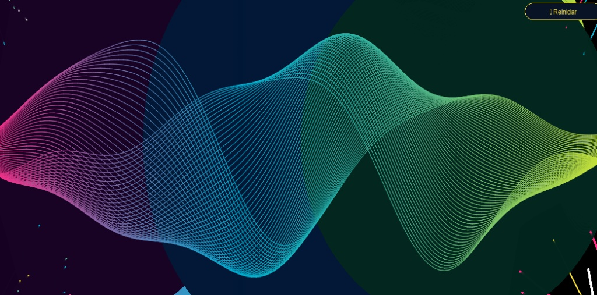

# 🌟 Eco Visual — Instalación Interactiva de Arte Generativo Sonoro

**Eco Visual** es una instalación artística multimedia interactiva desarrollada en Python. El sistema captura en tiempo real la voz del público a través del micrófono y la traduce dinámicamente en visuales generativos de alta fidelidad estética (estilo neón, 60 FPS estables), ofreciendo una experiencia inmersiva.

---

## 🎨 Características Principales

* **Aceleración por Hardware (Pygame):** Renderizado fluido a 60 FPS con suavizado de líneas (*antialiasing*) y efectos de resplandor (*glow*) de calidad profesional.
* **Tres Modos Visuales Interactivos:**
  1. **Onda Espectral Pro:** Un haz volumétrico de alta densidad (64 capas entrelazadas) con polvo estelar reactivo.
  2. **Matrix Dinámico:** Lluvia de código en cascada con velocidad variable dependiente de la intensidad de la voz.
  3. **Ecualizador Neón 3D:** Barras simétricas con perspectiva de suelo en rejilla tridimensional con brillo neón y reflejos especulares.
* **Interacción por Voz:** Análisis de amplitud de audio en tiempo real mediante `sounddevice` y `numpy`.
* **Modo Congelación (*Freeze*):** Búfer de captura de 3 segundos ("firma de voz") que congela la obra en su punto máximo de expresión para la interacción del usuario.

---

## 🛠️ Tecnologías Utilizadas

* **Python 3.12** — Lenguaje base de programación.
* **Pygame** — Motor gráfico y gestión de eventos de la interfaz.
* **NumPy** — Procesamiento matemático de señales y cálculos de audio (RMS).
* **SoundDevice** — Interfaz de captura de audio de baja latencia mediante micrófono.

---

## 📂 Arquitectura del Proyecto

El código fuente está modularizado bajo un diseño orientado a objetos riguroso, garantizando escalabilidad y buenas prácticas de ingeniería de software:

eco_visual_arte:
  src
    main.py             # Punto de entrada minimalista (Bootstrap)
    app.py              # Clase principal que encapsula el estado y el bucle de renderizado (60 FPS)
    audio_manager.py    # Gestión del flujo de audio y cálculo RMS
    ui_manager.py       # Renderizado de la interfaz gráfica y botones 
    input_handler.py    # Procesamiento de eventos de teclado y clics de interfaz
    style_spectral.py   # Lógica del Estilo 1 (Onda Espectral & Estrellas)
    style_matrix.py     # Lógica del Estilo 2 (Lluvia Matrix)
    style_eq.py         # Lógica del Estilo 3 (Ecualizador Neón 3D)

  preview.jpg             # Imagen de vista previa de la instalación
  README.md               # Documentación del proyecto

🚀 Guía de Instalación y Ejecución

1. Requisitos previos
Asegúrate de tener instalado Python 3.12 en tu equipo con la opción Add Python to PATH marcada.

2. Clonar o ubicar el proyecto
Abre tu terminal y dirígete a la carpeta del proyecto:

Bash
cd C:\eco_visual_arte

3. Instalar dependencias
Instala las librerías necesarias ejecutando el siguiente comando:

Bash
py -3.12 -m pip install pygame numpy sounddevice

4. Ejecutar la instalación artística
Inicia la aplicación con el punto de entrada:

Bash
py -3.12 src/main.py

🎮 Guía de Controles
Puedes interactuar con la instalación mediante el teclado o haciendo clic directamente en los botones flotantes de la interfaz (esquina superior derecha):

[ 1 ] : Activa el modo Onda Espectral.

[ 2 ] : Activa el modo Matrix Dinámico.

[ 3 ] : Activa el modo Ecualizador Neón 3D.

[ ESPACIO ] : Captura tu firma de voz (3 segundos) y congela la obra de arte resultante.

[ R ] : Reinicia la vista y restablece los generadores.

[ ESC / Cerrar ventana ] : Sale de la aplicación de forma limpia.